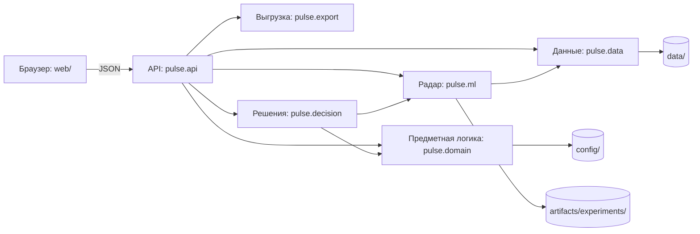

# Пульс маржи

Система для импортёра рецептурного лекарства в Узбекистане (задача №16, пример: ривароксабан 20 мг).
Она заранее оценивает вероятность пересмотра потолка цены и подбирает самый дешёвый план мер по закупкам,
логистике и контракту, чтобы импортёр пережил пересмотр без убытка и без перебоев с препаратом.

## Результаты

На реальных данных до 17.11.2026: 25 снимков реестра mpa.uz, 8 официальных списков пересмотров, курсы ЦБ РУз.

| Часть | Что показывает | Главная цифра |
| --- | --- | --- |
| Экономика упаковки | куда уходят 150 000 сум потолка | маржа 2,2%, ноль при курсе 12 322 сум/$ |
| История цен | референтные цены ривароксабана 20 мг по брендам | за два года 8 из 22 импортных брендов снижали цену, медиана −42% |
| Радар (ML) | вероятность снижения цены в следующей волне | AUC 0,68 по рынку и 0,80 [0,74–0,84] по импортным кардиопрепаратам на честном тесте; у правила 0,63 и 0,65 |
| Склад | потеря на складе при снижении потолка на 20% | 1,68 млрд сум без подготовки, 0,29 млрд с подготовкой |
| Оптимизатор | самый дешёвый план под цель маржи | цель 15%: 0,98 млрд сум и 8 месяцев, риск убытка за год 42% → 2% |

Ограничения и слабые места разобраны в [карточке модели](docs/model_card.md) и [реестре рисков](docs/RISKS.md).

## Как запустить и проверить

Нужны Python 3.12 и `make` (macOS или Linux; на Windows — WSL или Docker). Интернет нужен только для установки
зависимостей: все данные, на которых посчитаны цифры выше, уже лежат в репозитории.

```bash
git clone https://github.com/ArmanGOAT/pulse-marzhi.git
cd pulse-marzhi
make demo          # если Python 3.12 называется иначе: make demo PYTHON=python3
```

Дальше откройте http://localhost:8000 (страница демо) и http://localhost:8000/docs (схема API). `make demo`
выполняет шаги по порядку и пропускает уже сделанные:

| Шаг | Что делает | Время на MacBook |
| --- | --- | --- |
| `make setup` | окружение `.venv` с точными версиями из `requirements.lock` | ~40 с с кэшем pip, без кэша дольше |
| сборка панели | 25 снимков реестра → таблица из 334 185 строк в `data/processed/` | ~30 с, один раз |
| `make check` | печатает, что из данных на месте (то же отдаёт `GET /api/health`) | мгновенно |
| `make serve` | API и страница на порту 8000, остановка — Ctrl+C | ~1 с |

Если каких-то данных не хватает, `make demo` сам скачает их (`make data`, ~5 мин) и обучит радар
(`make train`, ~70 с). Страница в этом случае показывает красную полосу с командой, которая это исправит.

**Через Docker, без Python:**

```bash
docker compose up --build
```

Образ собирается из тех же данных и работает без сети, сервер внутри запущен не от root.

### Что лежит в репозитории

| Что | Где | Откуда |
| --- | --- | --- |
| 25 снимков реестра референтных цен, 1.11.2024 – 17.11.2026 | `data/raw/mpa_api/` + `manifest.json` с SHA-256 | публичный API mpa.uz |
| 8 официальных списков пересмотров | `data/raw/mpa/` | mpa.uz |
| курсы ЦБ USD, EUR, RUB за 47 месяцев | `data/raw/cbu/` | cbu.uz |
| отчёты всех 7 запусков радара и прогнозы основного запуска | `artifacts/experiments/` | `make train` |
| допущения с источником и статусом каждого числа | `config/` | условие задачи, законы, оценки команды |

Сырые файлы не меняются (ALCOA+). Собранные таблицы (`data/processed/`) в git не хранятся, они строятся из сырых
за ~30 секунд.

### Как проверить наши цифры

| Что проверить | Команда | Что должно получиться |
| --- | --- | --- |
| тесты-инварианты | `make test` | 67 тестов проходят |
| стиль кода | `make lint` | `All checks passed!` |
| радар с нуля | `make train` | новый запуск в `artifacts/experiments/`, AUC WoE-регрессии 0,715 на волне B и 0,681 на волне C |
| все запуски радара | `make runs` | таблица 7+ запусков с метриками |
| все цифры этого README | `make overview` | `docs/project-overview.json`, пересчитан теми же функциями, что и страница |
| данные взяты из первоисточника | `rm data/raw/mpa_api/registry_*.jsonl.gz && make data && make train` (~6 мин) | те же даты и почти те же строки; радар даёт AUC около 0,711 и 0,683 (см. ниже, почему не побайтно) |

**Почему перекачанные снимки не совпадают побайтно.** API mpa.uz отдаёт строки в разном порядке, и страницы
иногда пересекаются. Мы проверили это 18.11.2026 на чистом клоне: на каждый снимок расходится 0–1 упаковка из
~13 000, у упаковок-дубликатов меняется порядок, а снимок на 17.11 реестр успел обновить. Поэтому эталон — снимки
в `data/raw/mpa_api/` с SHA-256 в `manifest.json`: только на них получаются ровно наши цифры. Набор дат зафиксирован
по 17.11.2026; свежие снимки скачиваются отдельно командой `make data-latest`, и тогда цифры станут новее, чем в
этом README.

### Если что-то пошло не так

- **Порт 8000 занят** — остановите другой сервер (`lsof -ti tcp:8000 | xargs kill`) и повторите `make serve`.
- **`python3.12: command not found`** — укажите свой Python 3.12: `make demo PYTHON=python3`.
- **Нет `make` (Windows)** — используйте Docker или WSL.
- **Красная полоса «Не все данные загружены»** — в ней написано, какой команды не хватает; после неё перезапустите `make serve`.

## Демо

Пять экранов на живых данных: экономика упаковки и курс, история цен по реестру, радар пересмотров
(проверка на прошлой волне и прогноз на сейчас), склад в день пересмотра, план мер с риском и облаком стратегий.
Кнопка «▶ Показ» или клавиша `P` включает режим презентации: пробел ведёт по сценарию из восьми шагов
([сценарий и ответы на вопросы](docs/demo-script.md)). План выгружается в PDF для руководства и в Excel с расчётом.

| Метод | Адрес | Что возвращает |
| --- | --- | --- |
| GET | `/api/pack?fx=` | затраты на упаковку, маржа, безубыточный курс |
| POST | `/api/ceiling` | потолок по формуле приказа № 3735 на дату |
| GET | `/api/market/rivaroxaban` | история референтных цен по брендам |
| GET | `/api/radar` | метрики, сегменты, разбор волны B, прогноз по брендам |
| GET | `/api/stock?revision_day=` | запас по дням, потеря при пересмотре, когда готовиться |
| POST | `/api/plan` | план мер, риск до и после, все стратегии |
| POST | `/api/export/{pdf,xlsx}` | выгрузка плана |

## Развёртывание

Демо работает на https://pulse.modeus.cc. Каждый push в `main` проходит GitHub Actions: линтер и тесты,
образ из данных и отчётов радара, лежащих в git, публикация в GHCR, выкатка на сервер с проверкой здоровья
и откатом. Схема, секреты и ручные операции: [deploy/README.md](deploy/README.md).

## Данные и обучение

```bash
make data         # докачать недостающие снимки реестра по 17.11.2026 и собрать таблицы
make data-latest  # снимки по сегодняшний день (для новой волны пересмотров)
make train        # подбор гиперпараметров на волне B, честный тест на волне C, отчёт эксперимента
make runs         # таблица всех запусков из artifacts/experiments/index.jsonl
```

Каждый запуск `make train` создаёт папку `artifacts/experiments/<дата-время>_<имя>/`: конфиг, окружение,
версии данных с SHA-256, все попытки подбора, метрики, признаки, прогнозы по упаковкам и сводку `summary.md`.
Гиперпараметры и сетка подбора лежат в `config/radar.yaml`, текущий основной запуск указан в `artifacts/experiments/LATEST`.

## Архитектура



Каждый слой зависит только от нижних, все расчёты выполняет Python, страница только показывает (ADR-0001, ADR-0002).
Решения записаны в [docs/adr](docs/adr/): слои, своя страница вместо Streamlit, данные «на дату» без подглядывания
в будущее, границы LLM.

## Структура

```
config/            допущения и рычаги с источником и статусом каждого числа (YAML)
config/regulation/ правила ценообразования с датами вступления в силу
data/raw/          исходные файлы, не меняются (ALCOA+: Original); скачиваются make data
data/processed/    обработанные таблицы с паспортами (*.meta.json: строки, SHA-256, источники),
                   в том числе панель реестра — сервер стартует с неё за доли секунды
data/reference/    аптечные цены ривароксабана в Ташкенте
src/pulse/
  data/            контракты данных, хранилище «на дату», загрузчики, панель реестра
  domain/          двойник упаковки, движок правил потолка, симулятор склада
  ml/              признаки, радар, журнал экспериментов, отчёт по сегментам
  decision/        сценарии Монте-Карло и оптимизатор плана мер
  api/             API на FastAPI, раздаёт и страницу демо
  export/          выгрузка плана в PDF и Excel
web/               страница демо и дизайн-система
tests/             тесты-инварианты
docs/              документация (ниже)
artifacts/         отчёты экспериментов радара
```

## Документация

| Документ | О чём |
| --- | --- |
| [Идея решения](https://claude.ai/artifact/BL4PFU62hRcfcSN5ew4GAR) | командный документ: проблема, инсайт, система, статус на 18.11.2026 |
| [docs/STANDARDS.md](docs/STANDARDS.md) | на какие стандарты ориентируемся и что сделано по каждому |
| [docs/model_card.md](docs/model_card.md) | карточка модели радара: данные, подбор, качество по волнам и сегментам, ограничения |
| [docs/datasheet.md](docs/datasheet.md) | паспорт данных: источники, сбор, обработка, ограничения |
| [docs/RISKS.md](docs/RISKS.md) | реестр рисков системы и их статус |
| [docs/design-system.md](docs/design-system.md) | дизайн-система страницы демо |
| [docs/demo-script.md](docs/demo-script.md) | сценарий демо на 2 минуты и ответы на вопросы |
| [docs/project-overview.json](docs/project-overview.json) | все ключевые цифры проекта в одном JSON, собирается кодом: `make overview` |
| [docs/adr/](docs/adr/) | архитектурные решения |

## Как помечаются цифры

У каждого числа есть статус: **факт** (условие задачи, закон, официальный источник) или **оценка** (допущение
команды, проверить на данных импортёра). Третий статус, **демо**, предусмотрен для синтетических данных; в текущей
версии они не используются. Статус хранится в `config/assumptions.yaml` и паспортах данных и показывается в
интерфейсе, PDF и Excel.
